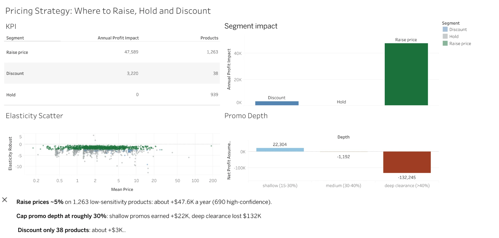

# E-commerce Pricing Strategy Analysis

**Question:** Which products should an online retailer raise, lower, or leave alone to maximize profit, and did past promotions pay off?

**Data:** [UCI Online Retail II](https://archive.ics.uci.edu/dataset/502/online+retail+ii): ~1.07M raw order lines from a UK online retailer, Dec 2009 – Dec 2011. No cost or promo fields exist; both are handled as explicit, labeled assumptions.

**Live dashboard:** [Pricing Strategy: Where to Raise, Hold and Discount (Tableau Public)](https://public.tableau.com/app/profile/manasa.chintakunta/viz/PricingStrategy_17926370439080/PricingStrategyWheretoRaiseHoldandDiscount)

**Headline findings** (see [RECOMMENDATION.md](RECOMMENDATION.md))
- Raising prices ~5% on low-sensitivity products is worth about +$47.6K/yr (+$34.7K from the high-confidence subset).
- Only shallow promos (15-30% off) were profitable; deep clearance (>40% off) lost about $132K under an assumed 60% cost.
- A naive elasticity estimate overstated price sensitivity by ~25% because bulk-discount orders create a fake price/quantity link.

## Stack
SQLite · Python (pandas, statsmodels, matplotlib) · log-log regression with month fixed effects · Tableau Public (dashboard)

## Pipeline
| Step | Script | Output |
|---|---|---|
| Clean 1.07M → 1.00M rows, load into SQLite | `src/01_load_clean.py` | `data/retail.db` |
| Elasticity per product, naive vs robust | `src/02_elasticity.py` | `outputs/elasticity_*.csv` |
| Promo analysis + raise/hold/discount segments | `src/03_promo_segments.py` | `outputs/promo_*.csv`, `segments.csv` |
| Charts | `src/04_charts.py` | `outputs/charts/*.png` |

Run in order with `.venv/bin/python src/0X_*.py` (needs pandas, numpy, statsmodels, openpyxl, matplotlib, scipy). Place `online_retail_II.xlsx` in `data_raw/` first.

## Method notes
- **Cleaning:** dropped exact duplicates, cancellations, non-positive qty/price and non-product codes (postage, fees): 6% of rows.
- **Robust elasticity:** weekly modal list price on lines of 24 units or fewer, so bulk-discounted orders cannot masquerade as price sensitivity.
- **Promo definition:** a week at least 15% below the product's median weekly price; post-promo window of 4 weeks; seasonality-adjusted.
- **Segmentation rule:** with margin m, a price rise is profitable when |e| < 1/m, a cut when |e| > 1/m. Cost is assumed at 60% of price; sensitivity shown at 50% and 70%.

## Limitations
Cost is assumed. Elasticities are observational (correlation, not causation); an A/B price test would confirm. Wholesale-size lines are excluded. Product-level estimates are noisy (cross-method correlation 0.64), so segment-level results are more reliable.
